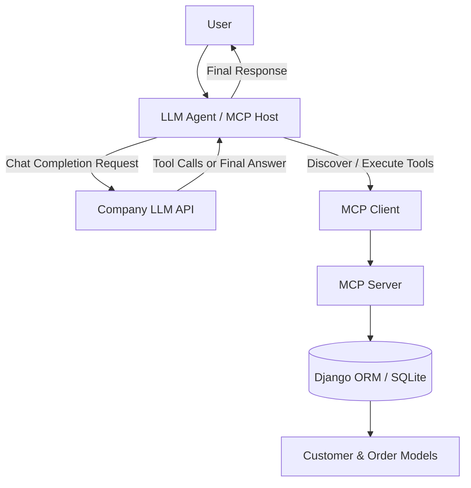
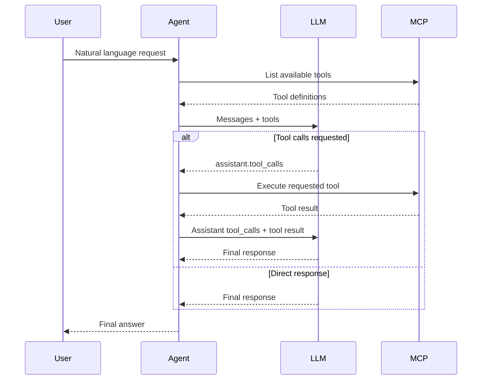

# Django MCP Agent

A lightweight LLM Agent built with Django, Model Context Protocol (MCP), and an OpenAI-compatible LLM API.

The project demonstrates how an LLM can interact with application data and external services through MCP tools. The LLM decides which tools to use, while the Agent handles tool discovery, execution, and conversation management.

## Overview

The project consists of three main components:

- **Django:** Application layer and data management.
- **MCP Server:** Exposes application capabilities as standardized MCP tools.
- **LLM Agent:** Connects to the company LLM API, discovers MCP tools, and manages the tool-calling lifecycle.

The LLM does not directly access the database or execute application code. It requests tool execution through the Agent, which delegates the operation to the MCP Server.

## Architecture



### Components

#### 1. Django Application

Django manages application data and provides the ORM layer.

Current data models:

- `Customer`
  - `id`
  - `name`
  - `email`
  - `created_at`

- `Order`
  - `id`
  - `customer`
  - `amount`
  - `status`
  - `created_at`

Order statuses:

- `pending`
- `paid`
- `cancelled`

SQLite is used as the default database to keep the development environment lightweight.

#### 2. MCP Server

Location: `mcp_server/server.py`

The MCP Server exposes Django application capabilities as tools.

Current tools:

| Tool | Description |
|---|---|
| `ping` | Checks MCP Server availability. |
| `search_customers` | Searches customers by name or email. |
| `get_customer` | Retrieves a customer by ID. |
| `list_customers` | Lists customers with pagination. |
| `get_order` | Retrieves an order by ID. |
| `list_orders` | Lists orders with optional filters and pagination. |
| `get_order_stats` | Returns order statistics and financial aggregates. |

All current business tools are read-only.

The MCP Server is exposed through Streamable HTTP transport.

Default endpoint:

```text
http://localhost:8001/mcp
```

#### 3. LLM Agent

Location: `openai_agent.py`

The Agent acts as the MCP Host and coordinates communication between the LLM and MCP Server.

Responsibilities:

- Connects to the company LLM API.
- Establishes an MCP client session.
- Discovers available tools dynamically.
- Converts MCP tool definitions into OpenAI-compatible function definitions.
- Sends user messages and available tools to the LLM.
- Executes requested tools through MCP.
- Returns tool results to the LLM.
- Continues the interaction until the LLM generates a final response.

The Agent does not contain hardcoded business tool definitions. New MCP tools can be discovered without changing the Agent implementation.

## Tool Calling Lifecycle

The interaction follows the standard tool-calling workflow:

1. The user submits a natural-language request.
2. The Agent retrieves available tools from the MCP Server.
3. The Agent sends the conversation and tool definitions to the LLM.
4. The LLM either generates a direct response or returns `tool_calls`.
5. If tool calls are returned, the Agent executes each requested MCP tool.
6. Tool results are added to the conversation using the `tool` role and corresponding `tool_call_id`.
7. The Agent sends the updated conversation back to the LLM.
8. The process continues until a final assistant response is generated.



## Technology Stack

| Component | Technology |
|---|---|
| Language | Python 3.11 |
| Dependency management | uv |
| Backend | Django |
| Database | SQLite |
| Tool protocol | Model Context Protocol |
| MCP transport | Streamable HTTP |
| LLM integration | OpenAI Python SDK |
| LLM API | Company OpenAI-compatible API |
| Configuration | Environment variables / python-dotenv |

## Project Structure

```text
dj-mcp-demo/
├── core/
│   ├── settings.py
│   └── ...
├── sample/
│   ├── models.py
│   ├── admin.py
│   └── ...
├── mcp_server/
│   ├── __init__.py
│   └── server.py
├── scripts/
│   └── seed_fake_data.py
├── openai_agent.py
├── test_client.py
├── manage.py
├── pyproject.toml
├── uv.lock
├── .env
├── .env.example
├── .gitignore
└── README.md
```

## Setup and Installation

### Prerequisites

- Python 3.11+
- uv
- Access to the company LLM API
- A valid LLM API token

### 1. Clone the repository

```bash
git clone <repository-url>
cd dj-mcp-demo
```

### 2. Install dependencies

```bash
uv sync
```

If dependencies have not been added yet:

```bash
uv add django "mcp[cli]" openai python-dotenv
```

### 3. Configure environment variables

Create a `.env` file in the project root:

```env
# Django
SECRET_KEY=your-django-secret-key
DEBUG=True

# Company LLM API
LLM_BASE_URL=http://your-llm-host:3002/v1
LLM_API_KEY=your-api-token
LLM_MODEL=your-model-name

# Request headers
LLM_USER_ID=demo-user
LLM_REQUEST_ID=dj-mcp-demo
LLM_SESSION_ID=Session999

# MCP
MCP_URL=http://localhost:8001/mcp
```

Replace the example values with the actual configuration provided by the LLM service administrator.

Do not commit `.env` or expose API tokens in source control.

Note: The actual LLM model name and API endpoint must match the company environment.

### 4. Apply Django migrations

```bash
uv run python manage.py makemigrations
uv run python manage.py migrate
```

### 5. Generate sample data

The project includes a script for generating fake customers and orders.

Generate 30 customers and 100 orders:

```bash
uv run python scripts/seed_fake_data.py
```

Generate a larger dataset:

```bash
uv run python scripts/seed_fake_data.py \
    --customers 100 \
    --orders 500
```

Reset existing customers and orders before generating new data:

```bash
uv run python scripts/seed_fake_data.py --reset
```

**Warning:** `--reset` deletes existing orders and customers. Use it only with a development database.

## Running the Project

The MCP Server and Agent run as separate processes.

### 1. Start the MCP Server

```bash
uv run python -m mcp_server.server
```

The server listens on:

```text
http://localhost:8001/mcp
```

### 2. Run the LLM Agent

Open another terminal:

```bash
uv run python -m openai_agent
```

Enter a natural-language request:

```text
Find customer with ID 1 and tell me their name and email.
```

The Agent discovers available MCP tools and lets the LLM decide which tool to execute.

## Example Requests

The following requests can be used to test the Agent:

**Customer lookup**

```text
Find the customer named Hossein.
```

**Customer details**

```text
Get the details of customer ID 1.
```

**Order history**

```text
Show the last 5 orders of customer 1.
```

**Paid orders**

```text
How many paid orders does customer 1 have?
```

**Order details**

```text
Find order ID 3 and tell me who placed it.
```

**Business statistics**

```text
Give me an overview of all orders, including total and paid amounts.
```

**Combined query**

```text
Find the customer named Ali and summarize their orders.
```

## Testing MCP Tools Independently

The project also includes a Python MCP client for testing the server without involving the LLM.

```bash
uv run python test_client.py
```

This is useful for distinguishing MCP connectivity and tool execution issues from LLM integration issues.

## Architecture Decisions

### 1. MCP as the Tool Integration Layer

MCP is used as the standardized interface between the Agent and application capabilities.

The Agent does not need to know how each tool is implemented or which database it accesses.

This allows new tools and integrations to be added without changing the Agent's core logic.

### 2. Dynamic Tool Discovery

Tool definitions are retrieved from the MCP Server at runtime.

The Agent converts MCP input schemas into OpenAI-compatible function definitions.

This avoids maintaining a separate tool registry inside the Agent.

### 3. Company LLM API

The company-provided LLM API is used instead of running a local model.

The API follows the OpenAI Chat Completions format and supports function calling.

The OpenAI Python SDK is used as the client because it supports custom API base URLs.

### 4. Separation of Responsibilities

Each component has a single responsibility:

- Django owns application data and business models.
- MCP Server exposes application operations.
- Agent manages conversation state and tool execution.
- LLM selects tools and generates natural-language responses.

The LLM does not directly access the database.

### 5. Read-only Tools First

Initial tools are intentionally read-only.

This reduces the risk of unintended data modifications while validating tool selection, execution, and response generation.

Write operations can be introduced later with appropriate authorization and validation.

### 6. Lightweight Development Environment

SQLite is used for the initial implementation.

The goal is to validate the MCP and Agent architecture without introducing unnecessary infrastructure.

## Current Scope

| Feature | Status |
|---|---|
| Django application | Implemented |
| Customer and Order models | Implemented |
| MCP Server | Implemented |
| Streamable HTTP transport | Implemented |
| MCP tool discovery | Implemented |
| Company LLM integration | Implemented |
| OpenAI-compatible function calling | Implemented |
| MCP tool execution through Agent | Implemented |
| Fake data generation | Implemented |
| Aerospike integration | Planned |
| Tool authorization and access control | Planned |
| Persistent conversation history | Planned |
| Write operations | Planned |

## Future Improvements

Potential next steps:

1. Integrate Aerospike as another MCP tool provider.
2. Add structured error handling and logging.
3. Add tool-level authorization and validation.
4. Support persistent conversation sessions.
5. Add tests for MCP tools and Agent execution.
6. Introduce write operations with explicit confirmation where necessary.

## Security Notes

- Keep API tokens and Django secrets in environment variables.
- Never expose credentials through tool descriptions or tool outputs.
- Validate tool inputs before executing database operations.
- Apply authorization at the tool or service layer before introducing write operations.
- Avoid exposing the MCP Server publicly without authentication and network restrictions.
- Use a separate development database for fake data generation.

## License

Internal development / experimental project.
